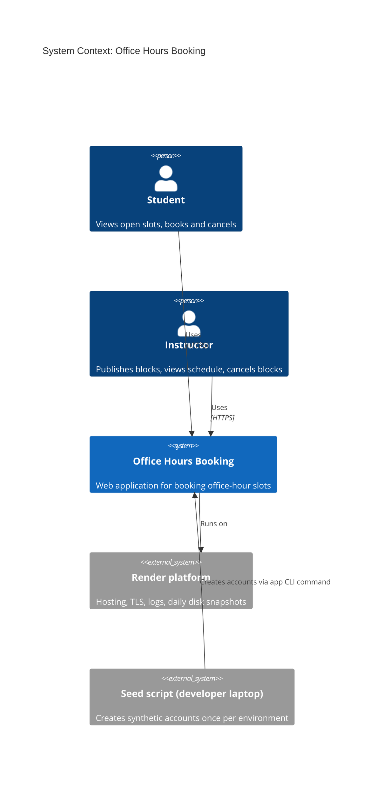
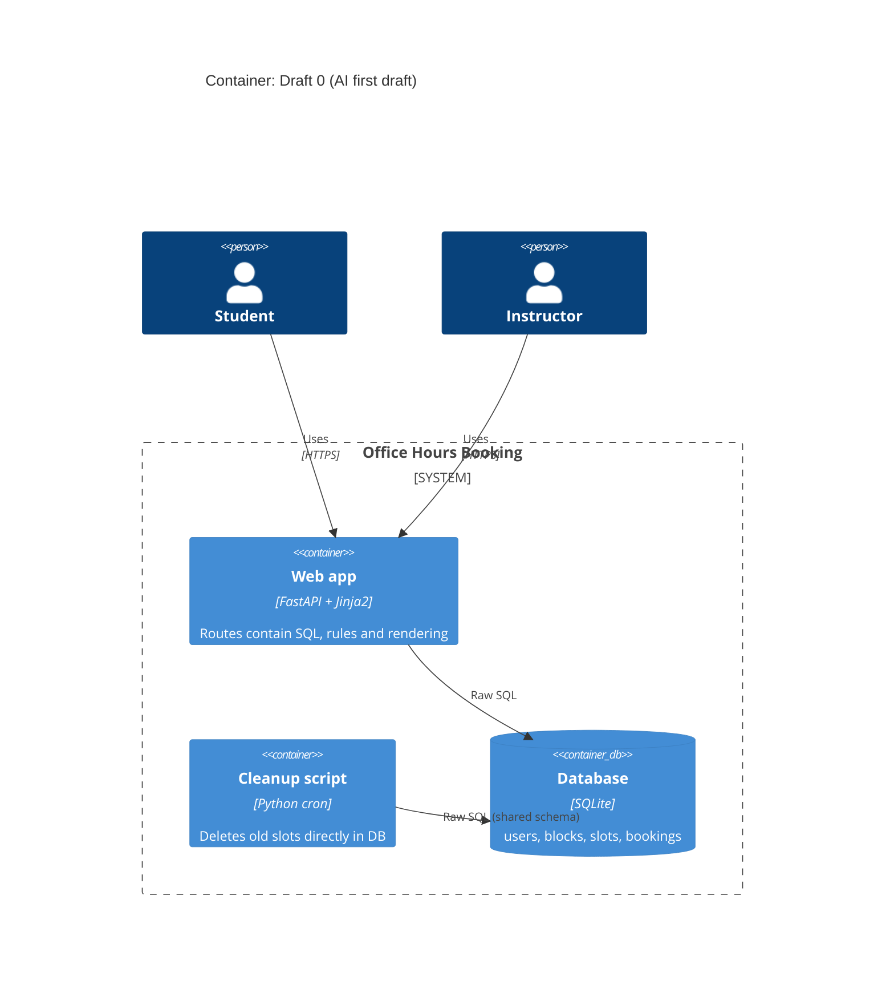
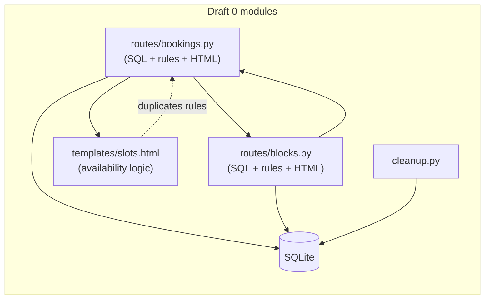
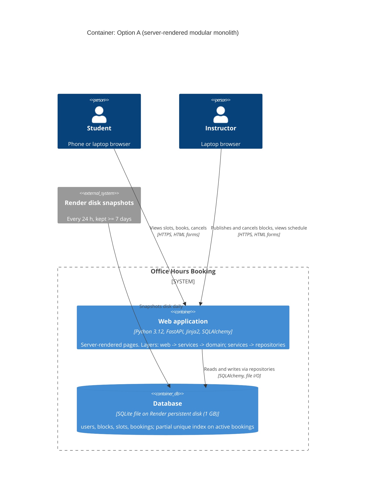
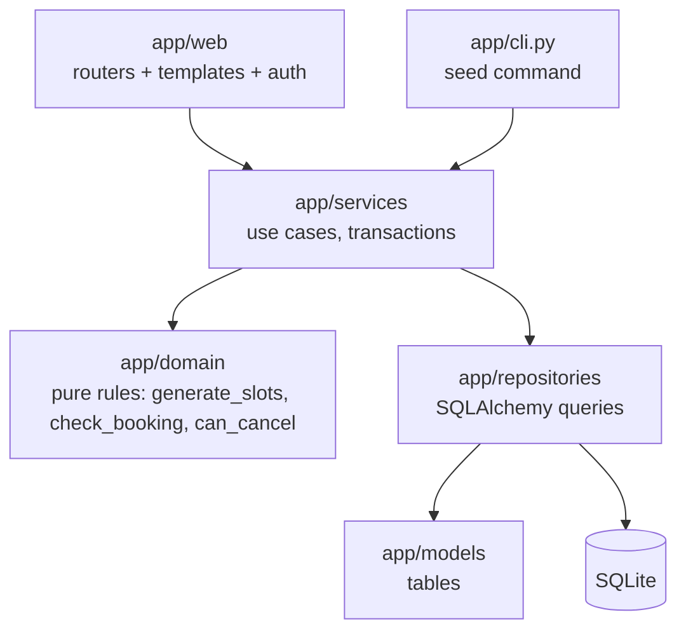
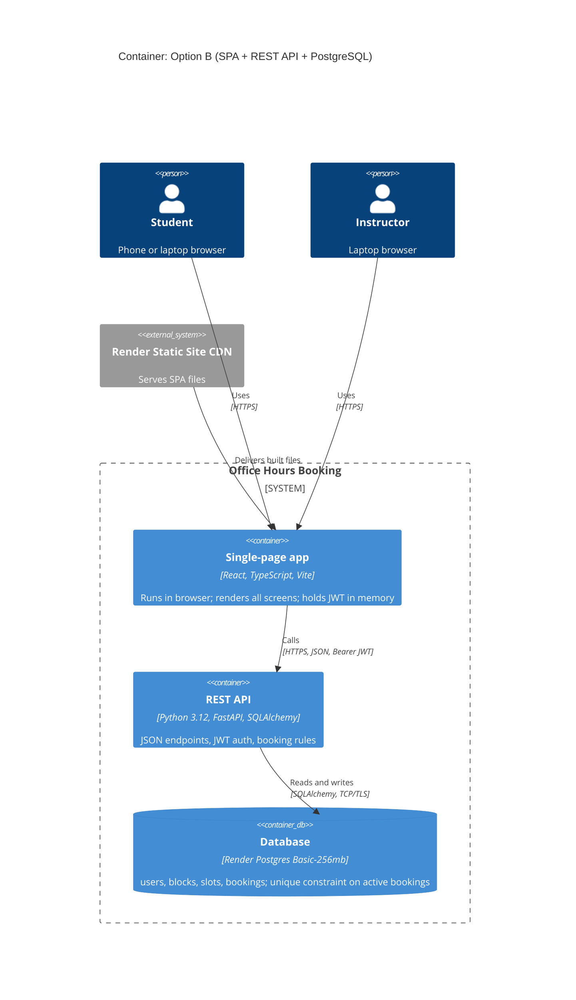

# Architecture Options: Office Hours Booking

This file contains:

1. **Draft 0**: a naive first-cut architecture generated by the AI assistant (how it was produced is recorded in [AI_USE_DISCLOSURE.md](../../AI_USE_DISCLOSURE.md)). It is kept as evidence and is **not** a candidate.
2. **Option A**: a server-rendered modular monolith with SQLite. **Chosen** ([ADR-001](../adr/ADR-001-server-rendered-modular-monolith.md)).
3. **Option B**: a single-page app (SPA) plus a JSON REST API with managed PostgreSQL. **Rejected**.
4. A distinctness check, and a comparison of the AI draft with the two options.

Both options are compared in the [trade-off matrix](TRADEOFF_MATRIX.md), checked for coupling in the [coupling check](COUPLING_CHECK.md) and costed in the [cost model](../COST_MODEL.md).

There are no agents in this project. It is an App, and the product has no AI (NG-10), so there are no agent handoffs to show.

---

## Shared system context (same for both options)

At the context level both options look the same from the outside: two kinds of people use one system hosted on one platform.

---

## Draft 0: AI first draft (kept as evidence, not a candidate)

Draft 0 is a FastAPI app where each route handler does everything. Problems found in review:

- Route handlers run raw SQL, apply the booking rules and render HTML, all in one function.
- `blocks.py` imports `bookings.py` to cancel bookings, and `bookings.py` imports `blocks.py` to check block status. That is a **dependency cycle**.
- The Jinja2 template computes "is this slot available?", which duplicates rule logic in the view.
- A separate cleanup script writes directly to the same tables, which means **two containers share one database schema**.
- It calls `datetime.now()` inside the rules, so the rules can't be tested at exact boundaries (SC-04, SC-05).

---

## Option A: Server-rendered modular monolith + SQLite (CHOSEN)

**Idea:** one Python process serves HTML pages. The code is split into layers that only depend downward, and all booking rules live in a pure `domain` package with no imports from web or database code.

- **Web layer** (`app/web`): FastAPI routers and Jinja2 templates. Handles HTTP, sessions and role checks only.
- **Service layer** (`app/services`): use cases such as `book_slot` and `cancel_block`. Opens a transaction, loads data through repositories, calls the domain rules and saves the result.
- **Domain layer** (`app/domain`): pure functions such as `generate_slots`, `check_booking` and `can_cancel`. It receives `now` as a parameter and has no I/O.
- **Repository layer** (`app/repositories`): SQLAlchemy queries. This is the only code that touches the database.
- **Persistence:** a SQLite file on a Render persistent disk. A partial unique index enforces one active booking per slot ([ADR-003](../adr/ADR-003-db-enforced-double-booking-prevention.md)).
- **Auth:** a signed, HttpOnly session cookie (Starlette `SessionMiddleware`), a `role` column, and bcrypt hashes.
- **Deploy:** one Render web service (Starter) with a 1 GB disk. Render takes daily disk snapshots.

**Component dependencies (allowed directions only):**

`app/domain` depends on nothing in the app, only on the standard library (`datetime`, `dataclasses`). The seed command goes through the services, so no second container writes to the database directly.

---

## Option B: SPA + JSON REST API + managed PostgreSQL (REJECTED)

**Idea:** split the UI and the backend. A React single-page app runs in the browser and calls a stateless JSON API, and the data lives in a managed PostgreSQL database.

- **SPA:** React + TypeScript, built to static files and served by a Render Static Site.
- **API:** FastAPI JSON endpoints with JWT bearer tokens and an OpenAPI schema.
- **Persistence:** Render Postgres (Basic-256mb). An exclusion/unique constraint on active bookings, with a connection pool.
- **Deploy:** two Render services (static site + web service) plus one managed database, all on one deployment target (Render).

---

## Distinctness check

Two options are only "genuinely distinct" if they differ on decisions that change how the system is built and run, not only on library names.

| Dimension | Option A | Option B | Different? |
|---|---|---|---|
| Where the UI is rendered | Server (Jinja2 HTML) | Browser (React SPA) | ✅ |
| Interface style | HTML form posts + redirects | JSON REST + OpenAPI | ✅ |
| Authentication | Signed session cookie | JWT bearer token | ✅ |
| Database | Embedded SQLite file | Managed PostgreSQL server | ✅ |
| Deployable units | 1 | 2 services + 1 database | ✅ |
| Languages | Python only (+ HTML/CSS) | Python + TypeScript | ✅ |
| Concurrency control | SQLite write lock + partial unique index | Postgres row locks + unique constraint | ✅ |
| Horizontal scaling | Not possible (disk is single-instance) | API can scale to more instances | ✅ |
| Domain rules module | Pure `app/domain` | Pure `app/domain` (same) | ❌ (deliberately kept the same) |

**Result:** 8 of 9 dimensions differ, so the options are distinct. The domain module is kept the same on purpose, so that the booking rules and their tests don't depend on which option is chosen.

---

## AI draft compared with the options

| Concern | Draft 0 (AI) | Option A | Option B |
|---|---|---|---|
| Where booking rules live | Spread across routes and templates | One pure `app/domain` package | One pure `app/domain` package |
| Dependency cycles | Yes (`blocks` ↔ `bookings`) | None | None |
| Containers sharing a DB schema | Yes (web app + cleanup script) | No (seed goes through services) | No |
| Testable at exact time boundaries | No (`datetime.now()` inside rules) | Yes (injected `now`) | Yes (injected `now`) |
| Double-booking protection | Check-then-insert in Python (race-prone) | DB partial unique index | DB unique constraint |
| Coupling check | **Flagged** | **Cleared** | Cleared |

What we kept from the AI draft: FastAPI, Jinja2, SQLite and the four-table data model. What we rejected: the routes-do-everything structure, the cleanup script, the clock inside the rules, and check-then-insert booking. Each rejection is recorded in the disclosure log.
